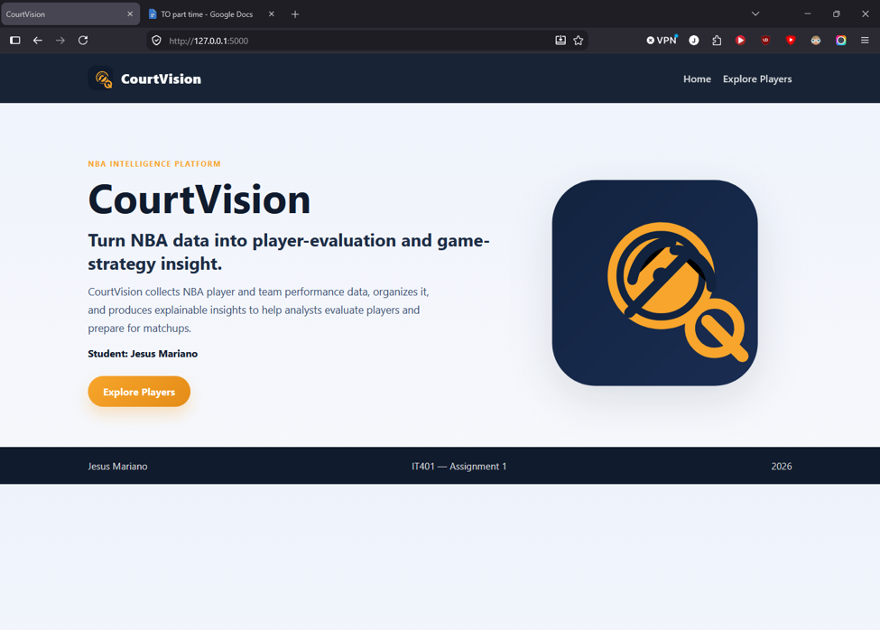
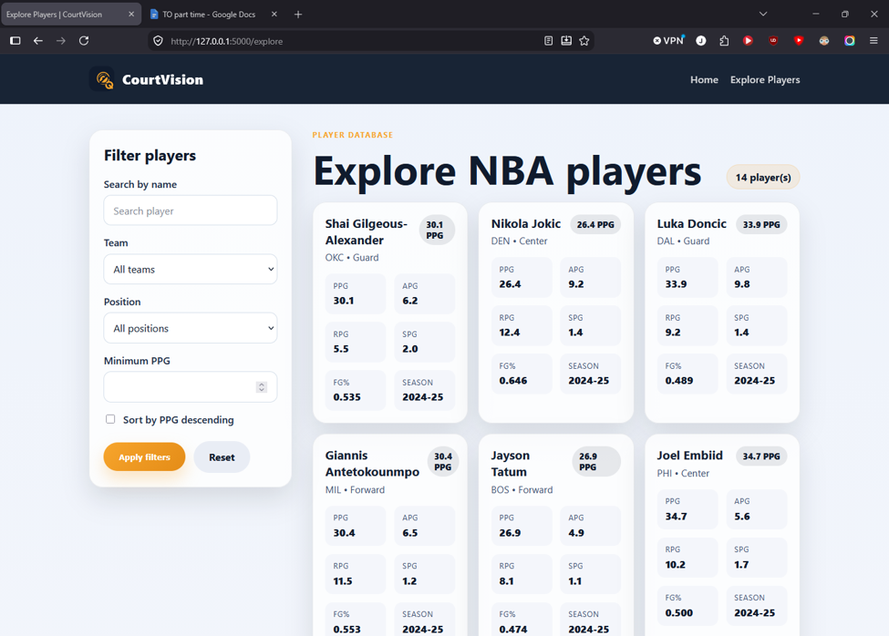
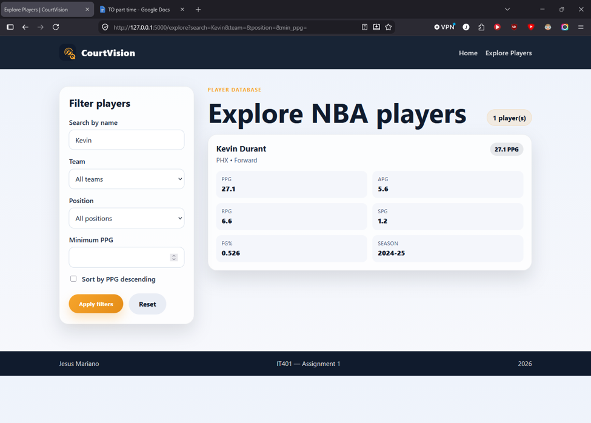
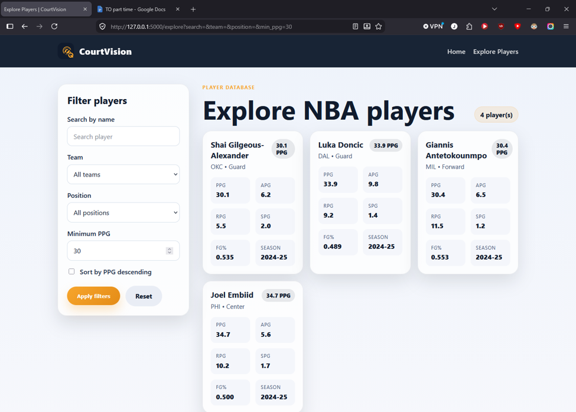
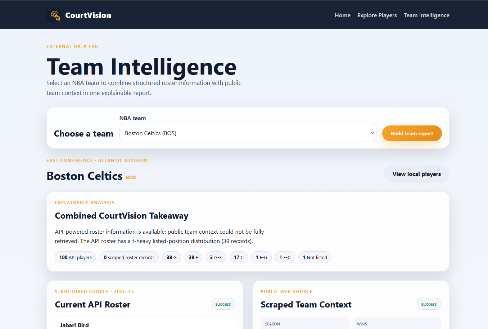
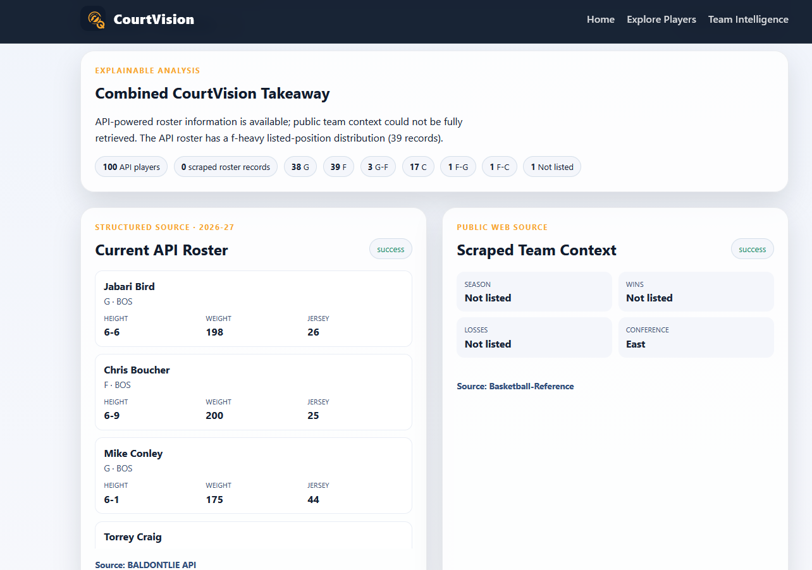

# CourtVision — Jesus Mariano — IT401 — Assignment 3

## Project Title

CourtVision — Jesus Mariano — IT401 — Assignment 3

## Project Overview

CourtVision is a Flask and Jinja2 basketball intelligence prototype for NBA player evaluation and team-strategy analysis. The project keeps the server-rendered architecture from A1/A2 while extending it with persistent saved-player records in MySQL through Flask-SQLAlchemy.

This A3 version preserves the existing local Explore workflow, the Team Intelligence page, external API integration, scraping integration, and the source-specific failure handling used in Assignment 2. The main A3 addition is explicit persistence for a focused Saved Player Record model that users can create, read, update, and delete through the web interface.

## A1 → A2 → A3 Progression

- A1: local JSON player dataset and filters.
- A2: team intelligence combining BALDONTLIE and Basketball-Reference data.
- A3: database-backed saved player records stored in MySQL.

## Information Persistence

CourtVision now persists a focused set of player records in MySQL. These records include current roster identity data from BALDONTLIE as well as manually created scouting notes. Saved records survive restarts and are available for search, detail viewing, editing, and delete confirmation without re-calling the external API.

The A1 `data/players.json` file remains a local static dataset and is not the application persistence layer. API and scraper results stay independent and unsaved unless the user explicitly chooses to save a player record.

## Database Schema

Table name: `saved_player_records`

Core fields:

- `id` — integer primary key
- `name` — required player name
- `description` — required note or scouting description
- `source` — provenance label such as `BALDONTLIE` or `Manual`
- `source_url` — nullable URL for an external source or manual reference
- `retrieved_at` — UTC timestamp for imported external records
- `created_at` — UTC timestamp for creation
- `updated_at` — UTC timestamp for the latest local modification
- `external_player_id` — nullable BALDONTLIE player identifier
- `team_name` — team name from source or local validation
- `team_abbreviation` — normalized NBA team abbreviation
- `position` — normalized player position
- `height` — physical measurement value
- `weight` — physical measurement value
- `jersey_number` — preserved as a string so values like `00` remain valid

Unique constraint:

- `(source, external_player_id)` for imported BALDONTLIE records

This is a minimal model with no relationship tables. It stores current saved records rather than an authoritative historical roster history.

## Application Architecture

- `app.py` — Flask factory and CLI entry point
- `config.py` — environment-driven configuration and MySQL URL builder
- `extensions.py` — shared SQLAlchemy extension instance
- `models/saved_player_record.py` — saved player schema
- `routes/main.py` — A1/A2 routes and A3 saved-record CRUD routes
- `services/balldontlie_service.py` — BALDONTLIE API retrieval and normalization
- `services/basketball_reference_service.py` — defensive scraper for team context
- `services/team_intelligence_service.py` — combined report generation
- `templates/` and `static/` — server-rendered UI and stylesheet
- `data/` — local fallback JSON and team catalog

## Information Flow

```text
User selects player or creates a manual record
  -> server-side validation
  -> duplicate check and database constraints
  -> MySQL commit for persisted records
  -> saved-player list or detail page
```

For external API saves:

```text
Team Intelligence page
  -> BALDONTLIE active-player lookup
  -> matching external player ID validation
  -> duplicate detection with source + external_player_id
  -> MySQL row inserted
  -> record detail page with provenance
```

## Current Features

- Homepage and existing A1/A2 navigation
- Explore Players workflow using local JSON
- Team Intelligence with API + scraping
- MySQL-backed saved-player records
- Saved-player search by name, team, and source
- Create, view, edit, and delete saved records
- Validation for missing input, invalid team abbreviations, invalid URLs, and duplicate imports
- Graceful non-persistent mode when MySQL is not configured

## Installation Instructions

1. Clone the repo and switch to the A3 branch:

```bash
git checkout jesus-mariano-it401-a3
```

2. Create and activate a virtual environment:

```bash
python -m venv .venv
```

Windows PowerShell:

```powershell
.venv\Scripts\Activate.ps1
```

3. Install dependencies:

```bash
pip install -r requirements.txt
```

4. Create a `.env` file from the template:

```bash
Copy-Item .env.example .env
```

5. Add the required values in `.env`:

```text
BALDONTLIE_API_KEY=
SECRET_KEY=replace-with-a-random-local-secret
MYSQL_HOST=
MYSQL_PORT=3306
MYSQL_DATABASE=
MYSQL_USER=
MYSQL_PASSWORD=
MYSQL_SSL_CA=
```

6. Create the MySQL database/schema in CI-Keys before initializing tables.

7. Run the table-creation command:

```bash
flask --app app init-db
```

8. Start the app:

```bash
python app.py
```

9. Run the automated tests:

```bash
python -m pytest -q
```

## Environment Variables

- `BALDONTLIE_API_KEY` — API key used by the existing A2 team-intelligence API integration.
- `SECRET_KEY` — required for CSRF protection and secure forms.
- `MYSQL_HOST` — MySQL host or CI-Keys endpoint.
- `MYSQL_PORT` — MySQL port, default `3306`.
- `MYSQL_DATABASE` — schema name in the CI-Keys database.
- `MYSQL_USER` — username with permission to create tables.
- `MYSQL_PASSWORD` — MySQL password.
- `MYSQL_SSL_CA` — optional CA file path if the hosting environment requires it.

No secrets are committed to the repo.

## Error Handling

- Missing MySQL configuration shows a non-sensitive configuration notice instead of silently spawning an in-memory database.
- Invalid team abbreviations, blank names, blank descriptions, and invalid URLs are rejected with clear messages.
- Duplicate BALDONTLIE imports are blocked and linked back to the saved record.
- Manual duplicates are also blocked when the same manual record content is re-submitted.
- API errors, missing keys, and scraper outages remain independent and user-friendly.

## Screenshots

The repository includes static screenshots for the app's major UI states. These images are included here for a quick visual reference of the CourtVision workflow and the A3 saved-player experience.














Real screenshot verification is required when a student wants a fully evidenced submission. This repo does not claim screenshots for persistence verification beyond the code and tests shown here.

## Design Decisions

- MySQL persistence is used for the A3 requirement without replacing the existing server-rendered app.
- The saved-player model is intentionally minimal and focused on the assignment requirement.
- Current external API identity fields are treated as current roster identity, not season production metrics.
- `retrieved_at` is nullable for manual records because no external acquisition occurred.
- `jersey_number` remains a string to preserve values like `00`.
- Duplicate detection uses source and external player ID for imported records.
- Saving stays explicit; the app never auto-persists every live API response.

## Known Limitations

- This is a prototype without user authentication or multi-user ownership.
- Database-backed pages require a valid MySQL configuration.
- Search is intentionally lightweight and not a production-grade retrieval engine.
- API freshness depends on external service availability and rate limits.
- The assignment does not include automated migration tooling.

## Future Work

A4 could expand this into richer search, sorting, indexing, recommendation logic, and additional persistence for teams, games, and reports. For A3, the feature is intentionally focused on saved player records and CRUD.

## Project Structure

- `app.py` — app factory and Flask runtime
- `config.py` — database and app config
- `extensions.py` — SQLAlchemy instance
- `models/` — database model definitions
- `routes/main.py` — routes and validation logic
- `services/` — external data services and team intelligence
- `templates/` — Jinja templates for the app UI
- `static/` — CSS and site assets
- `tests/` — automated test coverage
- `.env.example` — safe environment template

## Git Workflow

The assignment branch is:

```bash
git branch --show-current
```

The project was created from the A2 branch and then developed on the A3 branch without overwriting unrelated work.

## Manual CI-Keys Verification Checklist

1. Confirm the MySQL schema exists in CI-Keys.
2. Set the required `MYSQL_*` values in `.env`.
3. Run `flask --app app init-db`.
4. Start the app.
5. Save an API-acquired player from Team Intelligence.
6. Confirm it appears on the Saved Players page.
7. Edit the record and confirm the update persists.
8. Delete the record and confirm it is removed.
9. Restart the Flask app and verify the record still persists if the database is configured and initialized.

## Verification Status

The workspace test suite passes with the A3 changes:

```bash
python -m pytest -q
```

Result: 21 passed.

## Notes

- Do not commit `.env` or any real database credentials.
- `flask --app app init-db` creates tables; it is not a migration system.
- The app remains server-rendered and uses Jinja2 templates.
